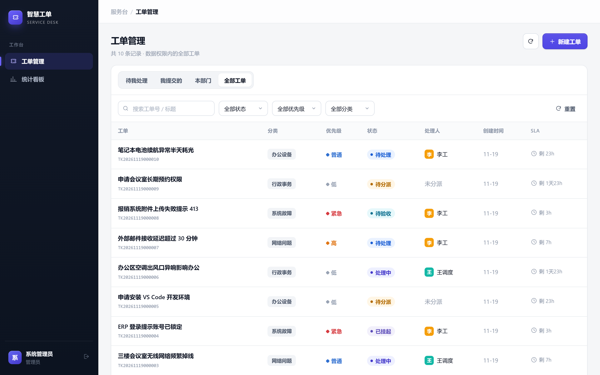
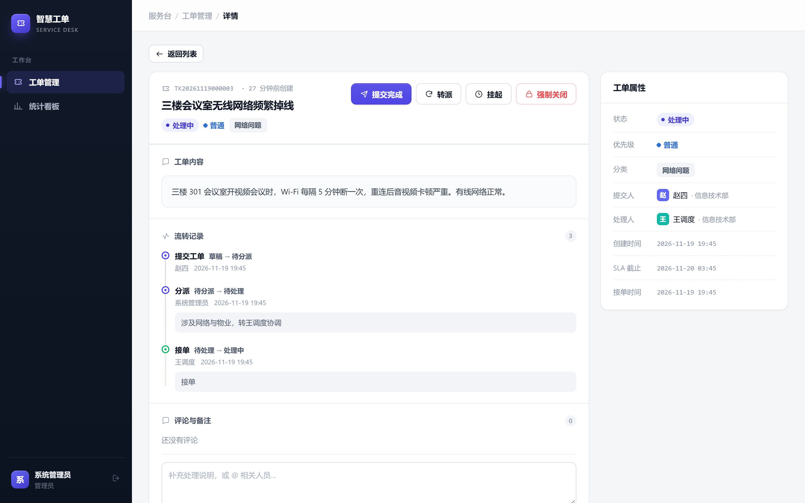
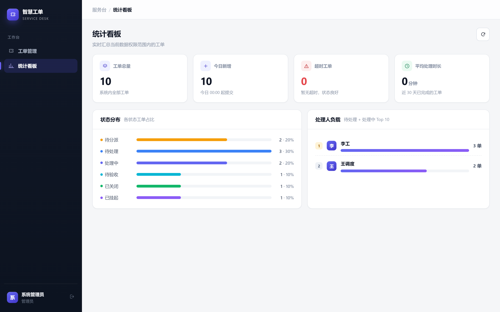
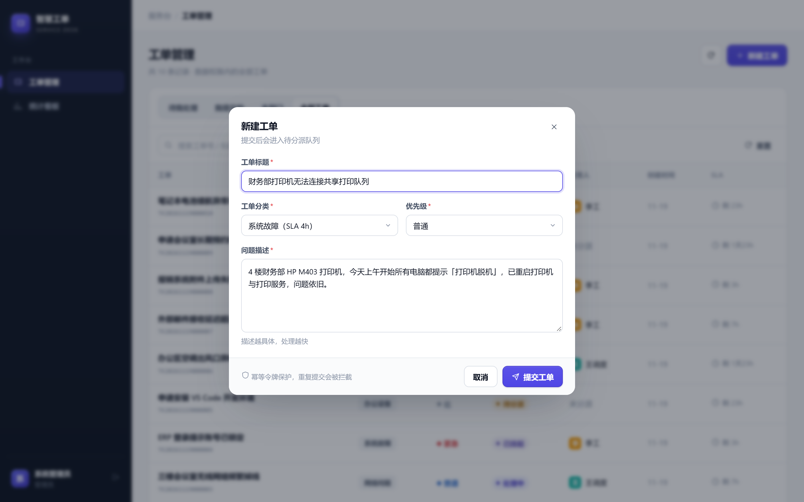

# 智慧工单管理系统

企业内部工单流转平台的完整实现（后端 + Web 前端），对应 `docs/ticket-system-design.md` 的设计文档。

**技术栈**：Java 17 / Spring Boot 3.2.5 / MyBatis 3.5 / MySQL 8.0 / Flyway / Maven
**前端**：原生 ES5 级 JavaScript + 手写 CSS，零构建、零 CDN、零框架依赖

**当前状态**：`mvn test` 107 个用例全绿；`mvn test -Dtest=TicketFlowIT` 3 项集成测试通过；
`bash scripts/smoke.sh` 19 项端到端检查全通过
（本机 MySQL 8.0.28 实测，含幂等拦截、越权拦截、状态机拦截）。

前端直接放在 `src/main/resources/static`，随 jar 一起发布，启动即可用。

## 界面预览

| 登录 | 工单列表 |
|---|---|
|  |  |

| 工单详情 | 统计看板 |
|---|---|
|  |  |

| 新建工单 | 移动端 |
|---|---|
|  |  |

---

## 1. 快速启动

### 1.1 前置条件

| 项 | 要求 |
|---|---|
| JDK | 17+ |
| Maven | 3.8+ |
| MySQL | 8.0+（库不用手动建，`createDatabaseIfNotExist=true` + Flyway 自动完成） |
| Redis | 可选。默认用进程内存储，不装也能跑全流程 |

### 1.2 启动

```bash
# 默认连接 127.0.0.1:3306，root/123456，库名 ticket_system
mvn spring-boot:run

# 或指定自己的数据库连接
DB_USER=root DB_PASSWORD=你的密码 mvn spring-boot:run

# 改端口（别用 ${SERVER_PORT} 占位符：它本身是 Spring 的环境变量约定，
# 优先级高于 application.yml，宿主预设了会静默覆盖配置）
mvn spring-boot:run -Dspring-boot.run.arguments=--server.port=9090
```

启动后：

- **Web 界面**：<http://localhost:8080/> —— 登录后即可见工单列表、详情、统计看板
- 接口文档（可在线调试）：<http://localhost:8080/swagger-ui/index.html>（`/doc.html` 会 302 跳到这里）
- 健康检查：`GET /v3/api-docs`（免登录）

### 1.2.1 前端说明

前端不是脚手架产物，是手工写的，刻意选了**零构建**方案：

| 决策 | 原因 |
|---|---|
| 纯静态文件放 `static/` | 不用装 Node、不用 `npm build`，`mvn spring-boot:run` 一键跑通；面试官克隆下来就能演示 |
| 不引 CDN | 内网/断网环境同样可用，也不会因为第三方 CDN 抖动导致页面白屏 |
| 无框架 | 渲染函数返回 HTML 字符串 + 事件委托，6.7 万字符 CSS 完全可控，没有主题覆盖战的成本 |
| 图标内联 SVG sprite | 省掉一个图标字体文件，也不会有 FOUT |

```
static/
├── index.html          外壳 + SVG 图标精灵
└── assets/
    ├── app.css         设计系统（配色/间距/组件），改主题只动 :root
    └── js/
        ├── api.js      API 客户端：解包 Result、401 全局拦截、幂等令牌
        ├── ui.js       转义、时间格式化、状态映射、Toast、Modal
        ├── views.js    纯渲染函数（返回 HTML 字符串）
        └── app.js      路由、事件委托、表单编排
```

页面清单：登录页 / 工单列表（4 个视图 tab + 多条件筛选 + 分页）/ 工单详情（时间线 +
评论区 + 按权限动态生成操作按钮）/ 统计看板（KPI + 状态分布 + 处理人负载）/ 新建工单弹窗。

> 安全上做了两件必要的事：所有渲染进 HTML 的用户数据都过 `UI.esc()`（工单标题、内容、
> 评论都是用户输入，漏一处就是存储型 XSS）；操作按钮虽由后端 `availableActions` 下发，
> 但真正的拦截仍在后端各接口，前端隐藏只是体验优化。

### 1.2.2 造演示数据

`scripts/seed-demo.py` 会**走真实 REST 接口**建 10 条工单并驱动状态流转
（分派 → 接单 → 完成 → 验收 / 挂起），因此流转日志、SLA 截止时间、版本号都是业务代码
真实算出来的，不是直接 INSERT 的空壳。

```bash
python scripts/seed-demo.py            # 默认 http://localhost:8080
```

### 1.2.3 离线接口文档

内网环境或预览面板访问不到 `localhost` 时，可导出一份**单文件静态 HTML**，双击即开、
不依赖服务、不引用任何 CDN：

```bash
# 服务运行中执行
curl -s http://localhost:8080/v3/api-docs -o docs/api-docs.json
python scripts/gen-api-html.py docs/api-docs.json docs/api-docs.html
```

产物 `docs/api-docs.html` 按「认证 / 幂等 / 工单 / 统计」分组，每个接口列出参数表、
请求体示例（可直接复制调试）、响应结构与示例，顶部支持关键词过滤。接口变更后重跑上面
两条命令即可更新。

### 1.3 演示账号（密码统一 `123456`）

| 账号 | 姓名 | 角色 | 部门 | 数据范围 |
|---|---|---|---|---|
| `admin` | 系统管理员 | ADMIN | 总公司 | 全部 |
| `dispatcher` | 王调度 | DISPATCHER | 信息技术部 | 本部门 |
| `handler` | 李工 | HANDLER | 运维组 | 本人 |
| `employee` | 张三 | EMPLOYEE | 行政部 | 本人 |
| `employee2` | 赵四 | EMPLOYEE | 信息技术部 | 本人 |

> 账号由 `AdminInitializer` 在启动时创建（按用户名幂等）。密码哈希用运行时同一个
> `PasswordEncoder` 生成 —— 手写进 SQL 的 BCrypt 哈希无法自校验，容易造成"文档写着能登、
> 实际登不进"。

### 1.4 一键冒烟

```bash
bash scripts/smoke.sh
```

跑通：登录 → 取幂等令牌 → 提交 → 分派 → 接单 → 完成 → 验收 → 查时间线，
并验证**重复提交被拦截**。

---

## 2. 目录结构

```
src/main/java/com/example/ticket/
├── TicketApplication.java
├── common/                    公共基础层
│   ├── api/                   Result / PageResult
│   ├── exception/             ErrorCode / BizException / 全局异常处理
│   ├── context/               LoginUser / UserContext / IdempotentContext
│   ├── annotation/            @RequirePerm / @DataScope / @Idempotent
│   ├── aspect/                数据权限切面 / 幂等切面
│   ├── idempotent/            令牌存储抽象 + 进程内/Redis 双实现 + 兜底记录
│   ├── scope/                 ScopedQuery（可接收数据权限片段的查询对象）
│   ├── web/                   traceId 过滤器 / 鉴权拦截器 / MVC 配置
│   └── config/                BCrypt
├── auth/                      登录、会话存储（进程内/Redis）
├── system/                    用户/角色/权限/部门 Mapper、演示账号初始化
├── ticket/
│   ├── enums/                 TicketStatus（状态机）+ TicketAction
│   ├── entity/ dto/ vo/
│   ├── mapper/                工单 / 流转日志 / 评论 / 分类
│   ├── service/               业务编排 + 工单号生成
│   ├── controller/            REST 接口
│   └── job/                   超时扫描 / 幂等记录清理
└── stat/                      统计概览
```

资源目录：

```
src/main/resources/
├── application.yml
├── db/migration/     V1 建表 11 张、V2 基础数据（Flyway 版本化）
└── mapper/           TicketMapper.xml（动态 SQL + CAS + 游标分页）
```

---

## 3. 接口清单

所有接口前缀 `/api/v1`，除登录外都需要 `Authorization: Bearer <token>`。

| 方法 | 路径 | 说明 | 权限点 / 特殊头 |
|---|---|---|---|
| POST | `/auth/login` | 登录 | 匿名 |
| GET | `/auth/me` | 当前用户与权限 | 登录 |
| POST | `/auth/logout` | 登出 | 登录 |
| GET | `/idempotent-token` | 取幂等令牌（300s 一次性） | 登录 |
| POST | `/tickets` | 提交工单 | `ticket:create` + `X-Idempotent-Token` |
| GET | `/tickets` | 工单列表（游标/偏移双模式） | 登录 + 数据权限 |
| GET | `/tickets/types` | 工单分类 | 登录 |
| GET | `/tickets/{id}` | 详情（含时间线、评论、可执行动作） | 登录 + 数据权限 |
| GET | `/tickets/{id}/flows` | 流转时间线 | 登录 + 数据权限 |
| PUT | `/tickets/{id}/assign` | 分派 | `ticket:assign` |
| PUT | `/tickets/{id}/accept` | 接单 | `ticket:handle` + 本人处理人 |
| PUT | `/tickets/{id}/finish` | 提交完成 | `ticket:handle` + 本人处理人 |
| PUT | `/tickets/{id}/verify` | 验收通过/驳回 | `ticket:verify` + 本人提交人 |
| PUT | `/tickets/{id}/transfer` | 转派（状态不变） | `ticket:handle` + 本人处理人 |
| PUT | `/tickets/{id}/suspend` | 挂起 | `ticket:handle` |
| PUT | `/tickets/{id}/resume` | 恢复 | `ticket:handle` |
| PUT | `/tickets/{id}/close` | 强制关闭 | `ticket:close` |
| PUT | `/tickets/{id}/reopen` | 重开（7 天内） | 本人提交人 |
| GET/POST | `/tickets/{id}/comments` | 评论 / 内部备注 | 登录 |
| GET | `/stats/overview` | 统计概览 | `stat:view` |

### 分页参数

```bash
# 偏移分页（跳页）
GET /api/v1/tickets?tab=all&pageNum=2&pageSize=20&needTotal=true

# 游标分页（推荐，恒定耗时、不漂移）
GET /api/v1/tickets?tab=all&pageSize=20&lastCreateTime=2026-11-18 10:00:00&lastId=123
```

`tab` 取值：`created` 我提交的 / `todo` 待我处理 / `dept` 本部门 / `all` 全部。
**归属人条件由服务端从登录态派生**，客户端传 `creatorId` 无效（DTO 上是 `@JsonIgnore`）。

---

## 4. 关键实现说明

### 4.1 状态机

8 个状态、13 条流转规则，集中在 `TicketStatus.ALLOWED` 一张表里：

```
草稿 0 ─提交→ 待分派 10 ─分派→ 待处理 20 ─接单→ 处理中 30 ─完成→ 待验收 40 ─验收→ 已关闭 50
                    └─驳回→ 已驳回 60        ├─退回→ 10        └─驳回→ 30        └─7天内重开→ 20
                                             └─挂起→ 已挂起 70 ─恢复→ 30
```

唯一合法判定入口是 `TicketStatus.assertCanTransit(from, to)`，业务代码里不允许散落
`if (status == 20 || status == 30)` 这类判断。单测对 8×8=64 种组合做了穷举。

### 4.2 幂等：三层防线

| 层 | 实现 | 拦什么 |
|---|---|---|
| 1 | `@Idempotent` 切面 + 令牌原子消费 | 用户连点、网络重试、并发重复请求 |
| 2 | `idempotent_record` 唯一索引 | Redis 挂了 / 令牌过期 / 绕过切面 |
| 3 | 状态机 CAS（`WHERE status=? AND version=?`） | 并发下的重复状态变更 |

**令牌为什么用 `DEL` 的返回值判断**：`GET` + `DEL` 两步之间有窗口期，两个并发请求可能
都读到值而都放行；`DEL` 单命令原子，返回 1 即"我删掉了它"。进程内实现用
`ConcurrentHashMap.remove()` 的返回值，同样是原子 CAS 语义 —— 有并发测试证明
16 线程抢同一令牌只有 1 个成功。

失败补偿：业务异常**不把令牌塞回去**。并发下回滚令牌会重复放行，宁可让用户重新取一次。

### 4.3 并发一致性

所有状态变更收敛到 `TicketServiceImpl.transit()`（private），用 `casUpdate` 一条语句
完成"校验前置状态 + 写入新状态"，影响行数为 0 抛 `40001 版本冲突`。

选择乐观锁而非 `SELECT ... FOR UPDATE` 的依据是**冲突概率**：同一张工单被两人同时
操作是小概率事件，乐观锁的重试成本远低于悲观锁的锁持有成本。如果换成秒杀库存，
结论应当反过来。

`transit` 是 private 的原因：Spring 的事务与切面基于代理，同类内部调用不经过代理，
把 `@Transactional` 标在 private 方法上是无效的（常见误用）。事务边界放在各 public 方法上。

### 4.4 工单列表查询优化

索引：`idx_assignee_status_ctime (assignee_id, status, create_time)`

- 等值列在前、范围列在后：`create_time` 既是范围又用于 `ORDER BY`，必须放末位
- SQL 改写同时做了三件事：只查 8 个必要字段（不查 TEXT 的 `content`）、日期用
  左闭右开区间（不在索引列上做函数运算）、`keyword` 只支持前缀匹配（`%x%` 无法走索引）

**20 万行实测（MySQL 8.0.28，`EXPLAIN ANALYZE`）**：

| 场景 | type | 扫描行数 | Extra | 耗时 |
|---|---|---|---|---|
| 无索引 | `ALL` | 198,402 | Using where; Using filesort | 42.3 ms |
| 有索引 + `status IN (20,30)` | `range` | **240** | Using index condition; Using filesort | 0.377 ms |
| 有索引 + `status = 30` | `ref` | 120 | **Backward index scan** | 0.227 ms |

一个容易想当然的点：`status IN (20,30)` 时 **filesort 并不会消失** —— `IN` 把索引扫描拆成
两段 range，跨段取值无法靠单次反向遍历满足排序。但它只对已过滤出的 240 行排序（约 0.04ms），
与无索引时 19.8 万行落 `sort_buffer` 完全不是一个量级。**判断标准是"排序输入多少行"，不是
"有没有 filesort"**。只有单值等值查询才拿得到 `ref` + `Backward index scan`。

复现方式：

```sql
EXPLAIN ANALYZE
SELECT t.id, t.ticket_no, t.title, t.status, t.assignee_id, t.create_time
FROM ticket t
WHERE t.deleted = 0 AND t.assignee_id = 101 AND t.status IN (20, 30)
ORDER BY t.create_time DESC, t.id DESC
LIMIT 0, 20;
```

详细推演见设计文档 6.1 节（含 6.1.3.1 实测校准）。

### 4.5 数据权限

`@DataScope` 切面把可见范围拼成 SQL 片段注入 `ScopedQuery`，Mapper 以 `${dataScope}` 引用。

**这是全项目唯一允许 `${}` 的地方**：片段完全由后端用 `Long` 类型的 userId/deptId 拼接，
不含任何用户可控字符串。新增类似用法必须在 Code Review 时单独说明理由。

读侧靠 SQL 片段，写侧靠 `checkOperator()` 显式校验"是不是你的单"——两层都要有，
只做一层就是水平越权漏洞。

### 4.6 状态追溯

`ticket_flow_log` 的写入点只有 `transit()` 一处，与主表更新在同一事务。
`operator_name` 在写入时冗余落库，所以追溯页是**固定 2 次查询**（主表 + 日志），
不随日志条数增加而增加，避免 N+1。

---

## 5. 测试

```bash
mvn test
```

| 测试类 | 覆盖点 |
|---|---|
| `TicketStatusTest` | 流转表与写死的业务约定比对、8×8=64 种组合、终态唯一性（防新增状态漏配规则）、未知码值 / null 状态 |
| `LocalIdempotentTokenStoreTest` | 令牌格式与唯一性、一次性、16 线程并发只有 1 个成功、过期失效、`isValid` 只读且不吃 null、清理任务只删过期 |
| `TicketServiceImplTest` | 分派（CAS 快照/冲突/处理人不存在/部门越界/软删）、越权 20003（接单与验收归属）、按钮权限矩阵、提交主路径与工单号重试、幂等唯一键兜底、分页上限与 tab 归属、重开窗口 |

共 **107** 个断言用例，全部不依赖数据库，`mvn test` 可直接跑。

另有一层集成测试（真实 MySQL + Flyway + MyBatis + AOP），覆盖单元测试用 Mock 替不掉的部分：Flyway 从空库建表、**真实并发下 CAS 只成功一次且只落一条日志**、`@DataScope` 拼出的 SQL 是否真的过滤掉别人的单。

```bash
mvn test -Dtest=TicketFlowIT     # 需要本机 MySQL；首次运行自动建 ticket_system_it 库
```

命名成 `*IT` 是刻意的：Surefire 默认只跑 `*Test`，所以 `mvn test` 始终不依赖外部环境。该测试每次启动会对 `ticket_system_it` 执行 Flyway `clean + migrate`，代码里校验了连接 URL 必须含 `_it`，指错库会直接失败而不是清库。

---

## 6. 与设计文档的偏差（有意为之）

| 设计文档 | 本实现 | 原因 |
|---|---|---|
| Sa-Token 做认证 | 自建 `SessionStore` + `@RequirePerm` | 本系统只需要"token → 登录态 + 注解校验"，自建约 200 行、零额外依赖、会话可换 Redis；避免为一个映射引入整套框架 |
| Redis 存幂等令牌 | 接口抽象 + 进程内/Redis 双实现，默认进程内 | 让项目**开箱即跑**（本机不必装 Redis）。`app.idempotent.store=redis` 即切换，业务代码零改动 |
| 工单附件 | 未实现 | 涉及对象存储/文件服务，属于独立议题；表结构与接口位已预留 |
| 异步通知（站内信/企微） | 未实现，`transit()` 后留了事务提交后的扩展点 | 通知渠道依赖外部系统，不影响核心流转 |

## 7. 已知限制

1. 会话与幂等令牌默认存进程内，**多实例部署需切 Redis**（`app.auth.store` / `app.idempotent.store`）。
2. `sys_permission` 只做了接口级权限点，未做菜单/按钮级树形授权。
3. 统计接口为实时聚合，数据量再上一个量级时应改为 `ticket_stat_daily` 预聚合。
4. 未做附件上传与全文检索（设计文档 V2 规划）。
